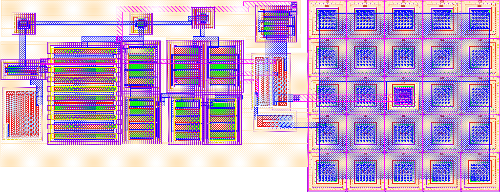
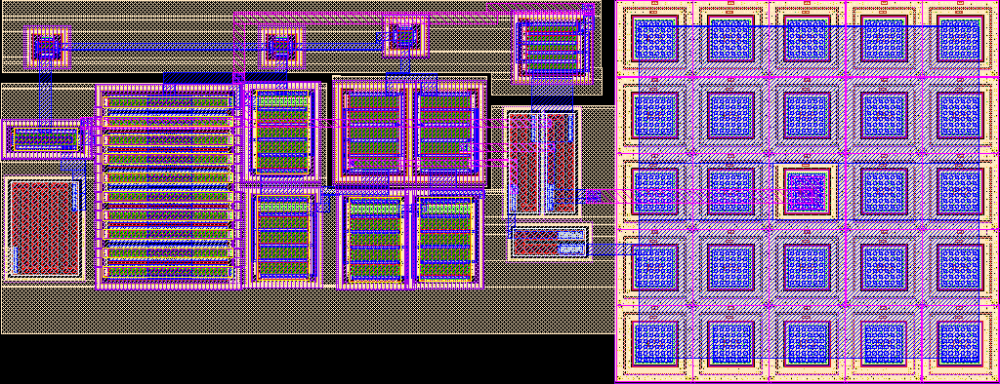

# bandgap

- Description: Bandgap reference
- PDK: sky130A

## Authorship

- Designer: Jonathan West
- Company: Weber State Univeristy
- Created: Nov 4, 2026
- License: Apache 2.0
- Last modified: None

## Pins

- Vref
  + Description: Reference voltage from bandgap (1.2V)
  + Type: signal
  + Direction: output
  + Vmin: vss
  + Vmax: vdd
- VDD
  + Description: Analog power supply
  + Type: power
  + Direction: inout
  + Vmin: 3.0
  + Vmax: 3.6
- GND
  + Description: Analog ground
  + Type: ground
  + Direction: inout
  + Vmin: -0.3
  + Vmax: 0.3

## Default Conditions

- vdd
  + Description: Analog power supply voltage
  + Display: vdd
  + Unit: V
  + Typical: 3.3
- vss
  + Description: Analog ground
  + Display: vss
  + Unit: V
  + Typical: 0
- temperature
  + Description: Ambient temperature
  + Display: Temp
  + Unit: °C
  + Minimum: 0
  + Typical: 27
  + Maximum: 80
- corner
  + Description: Process corner
  + Display: Corner
  + Minimum: ss
  + Typical: tt
  + Maximum: ff
- iterations
  + Description: Iterations to run
  + Display: Iterations
  + Minimum: 1
  + Maximum: 10
  + Step: linear
  + Stepsize: 1

## Symbol

## Schematic

## Layout

