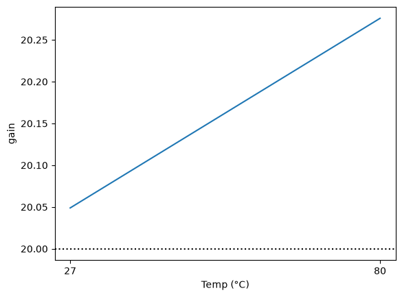

# CACE Summary for instamp

**netlist source**: rcx

|      Parameter       |         Tool         |     Result      | Min Limit  |  Min Value   | Typ Target |  Typ Value   | Max Limit  |  Max Value   |  Status  |
| :------------------- | :------------------- | :-------------- | ---------: | -----------: | ---------: | -----------: | ---------: | -----------: | :------: |
| Gain 26dB            | ngspice              | gain                 |           24 dB |  26.121 dB |        26 dB |  26.239 dB |        28 dB |  26.356 dB |   Pass ✅    |
| Gain 26dB            | ngspice              | bw                   |         100 kHz | 131.914 kHz |      300 kHz | 141.653 kHz |            ​ |          ​ |   Pass ✅    |
| Gain (20dB)          | ngspice              | gain                 |           18 dB |  20.049 dB |        20 dB |  20.162 dB |        22 dB |  20.276 dB |   Pass ✅    |
| Gain (20dB)          | ngspice              | bw                   |         100 kHz | 271.508 kHz |      200 kHz | 292.203 kHz |            ​ |          ​ |   Pass ✅    |
| Rise, fall and slew  | ngspice              | rise                 |          100 ns | 274.102 ns |       300 ns | 296.621 ns |       500 ns | 319.140 ns |   Pass ✅    |
| Rise, fall and slew  | ngspice              | fall                 |          100 ns | 250.614 ns |       300 ns | 270.858 ns |       500 ns | 291.103 ns |   Pass ✅    |
| Rise, fall and slew  | ngspice              | sr_rise              |        0.5 V/us | 0.693 V/us |     0.8 V/us | 0.743 V/us |     1.5 V/us | 0.792 V/us |   Pass ✅    |
| Rise, fall and slew  | ngspice              | sr_fall              |        0.5 V/us | 0.760 V/us |     0.8 V/us | 0.813 V/us |     1.5 V/us | 0.866 V/us |   Pass ✅    |
| Rise, fall and slew  | ngspice              | over                 |               ​ |          ​ |         1 mV |   0.175 mV |         3 mV |   0.308 mV |   Pass ✅    |
| Rise, fall and slew  | ngspice              | under                |               ​ |          ​ |         1 mV |   0.094 mV |         3 mV |   0.160 mV |   Pass ✅    |
| Rise, fall and slew  | ngspice              | ivdd                 |               ​ |          ​ |       500 uA |   0.000 uA |       750 uA |   0.000 uA |   Pass ✅    |
| CMRR and PSRR        | ngspice              | CMRR                 |           60 dB |  89.877 dB |        70 dB |  90.583 dB |            ​ |          ​ |   Pass ✅    |
| CMRR and PSRR        | ngspice              | PSRR                 |           60 dB |  83.183 dB |        70 dB |  83.440 dB |            ​ |          ​ |   Pass ✅    |
| Noise                | ngspice              | noise                |               ​ |          ​ |       100 uV | 229.460 uV |       300 uV | 238.048 uV |   Pass ✅    |
| Netgen LVS           | netgen_lvs           | lvs_errors           |               ​ |          ​ |            ​ |          ​ |            0 |          0 |   Pass ✅    |
| Magic DRC            | magic_drc            | drc_errors           |               ​ |          ​ |            ​ |          ​ |            0 |          0 |   Pass ✅    |
| Magic Antenna        | magic_antenna_check  | antenna_violations   |               ​ |          ​ |            ​ |          ​ |            0 |          0 |   Pass ✅    |

## Plots

## gain_vs_temperature

## gain_vs_temperature

