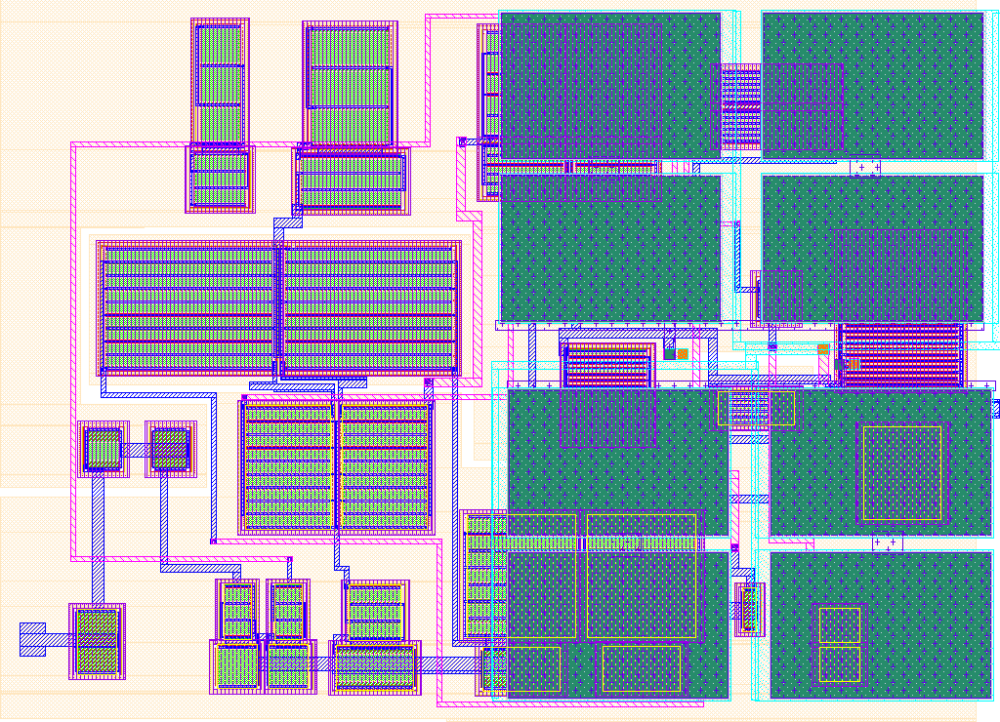
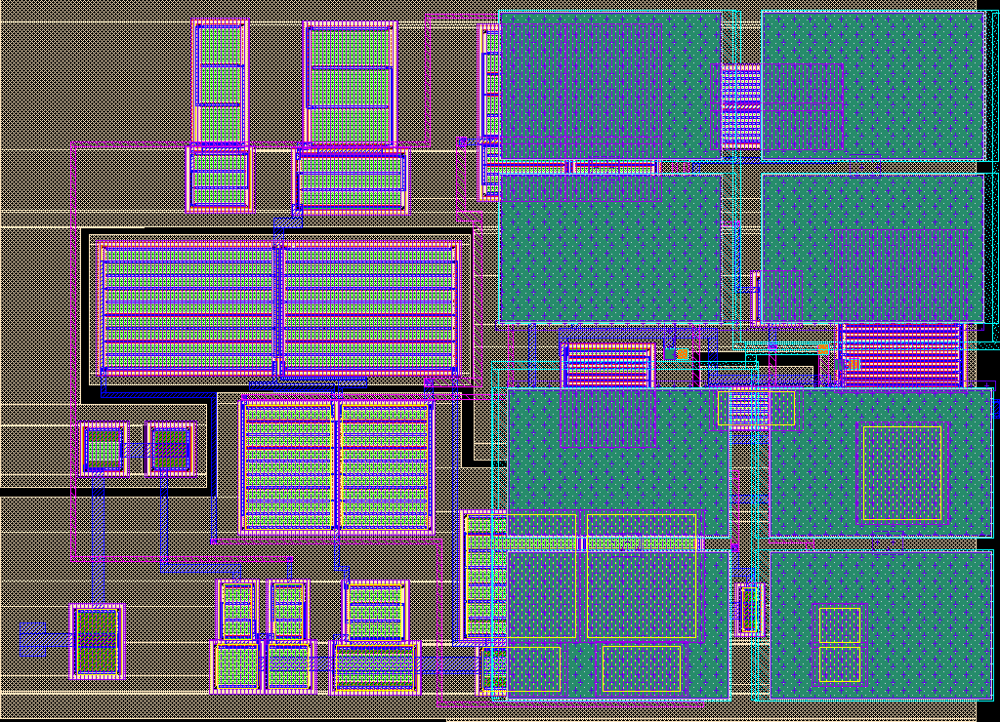

# opamp

- Description: Operational amplifier
- PDK: sky130A

## Authorship

- Designer: Jonathan West
- Company: Weber State Univeristy
- Created: Nov 4, 2026
- License: Apache 2.0
- Last modified: None

## Pins

- Vn
  + Description: amplifier voltage negative input
  + Type: signal
  + Direction: input
  + Vmin: vss - 0.3
  + Vmax: vdd + 0.3
- Vp
  + Description: amplifier voltage positive input
  + Type: signal
  + Direction: input
  + Vmin: vss - 0.3
  + Vmax: vdd + 0.3
- Vout
  + Description: amplifier voltage output
  + Type: signal
  + Direction: output
  + Vmin: vss
  + Vmax: vdd
- Vref
  + Description: Reference voltage from bandgap (1.2V)
  + Type: signal
  + Direction: output
  + Vmin: vss
  + Vmax: vdd
- VDD
  + Description: Analog power supply
  + Type: power
  + Direction: inout
  + Vmin: 3.0
  + Vmax: 3.6
- GND
  + Description: Analog ground
  + Type: ground
  + Direction: inout
  + Vmin: -0.3
  + Vmax: 0.3

## Default Conditions

- vdd
  + Description: Analog power supply voltage
  + Display: vdd
  + Unit: V
  + Typical: 3.3
- vmid
  + Description: Analog mid supply voltage
  + Display: vmid
  + Unit: V
  + Typical: 1.65
- vss
  + Description: Analog ground
  + Display: vss
  + Unit: V
  + Typical: 0
- vref
  + Description: reference voltage
  + Display: vref
  + Unit: V
  + Typical: 1.23
- Rfb
  + Description: Feedback resistance
  + Display: Rfb
  + Unit: MΩ
  + Typical: 10
- Rgnd
  + Description: Feedback to gnd resistance
  + Display: Rgnd
  + Unit: MΩ
  + Typical: 1
- Lfb
  + Description: Feedback inductance
  + Display: Lfb
  + Unit: H
  + Typical: 1G
- Cout
  + Description: Output load capacitance
  + Display: CLoad
  + Unit: fF
  + Maximum: 100
- Vmid
  + Description: Mid supply reference voltage
  + Display: Vmid
  + Typical: 1.65
- Vcm
  + Description: Common-mode input voltage
  + Display: Vcm
  + Typical: 0
- Vdiff
  + Description: Differential input voltage
  + Display: Vdiff
  + Typical: 0
- temperature
  + Description: Ambient temperature
  + Display: Temp
  + Unit: °C
  + Minimum: 0
  + Typical: 27
  + Maximum: 80
- corner
  + Description: Process corner
  + Display: Corner
  + Minimum: ss
  + Typical: tt
  + Maximum: ff
- iterations
  + Description: Iterations to run
  + Display: Iterations
  + Minimum: 1
  + Maximum: 10
  + Step: linear
  + Stepsize: 1
- Rg
  + Unit: kΩ
  + Typical: 17
- Rload
  + Unit: kΩ
  + Typical: 1000
- Cload
  + Unit: pF
  + Typical: 10

## Symbol

## Schematic

## Layout

