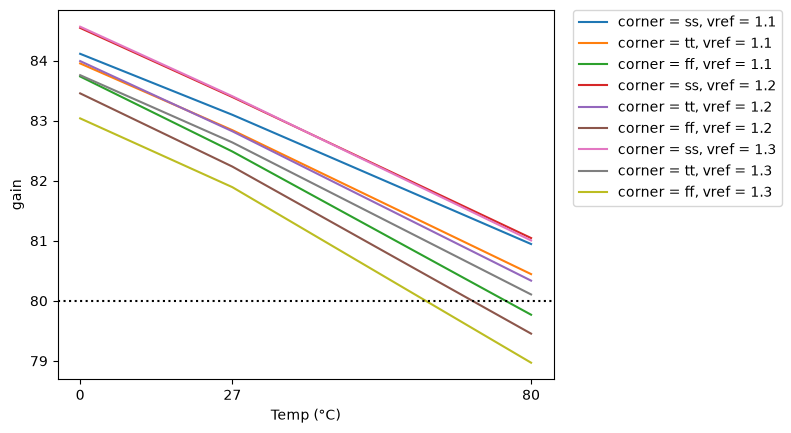

# CACE Summary for opamp

**netlist source**: rcx

|      Parameter       |         Tool         |     Result      | Min Limit  |  Min Value   | Typ Target |  Typ Value   | Max Limit  |  Max Value   |  Status  |
| :------------------- | :------------------- | :-------------- | ---------: | -----------: | ---------: | -----------: | ---------: | -----------: | :------: |
| Gain 20dB            | ngspice              | gain                 |           18 dB |  19.995 dB |        20 dB |  21.515 dB |        22 dB |  24.033 dB |   Pass ✅    |
| Gain 20dB            | ngspice              | bw                   |         100 kHz | 201.730 kHz |      300 kHz | 331.206 kHz |            ​ |          ​ |   Pass ✅    |
| Open loop gain       | ngspice              | gain                 |           70 dB |  78.970 dB |        80 dB |  82.822 dB |        90 dB |  84.563 dB |   Pass ✅    |
| Netgen LVS           | netgen_lvs           | lvs_errors           |               ​ |          ​ |            ​ |          ​ |            0 |          0 |   Pass ✅    |
| Magic DRC            | magic_drc            | drc_errors           |               ​ |          ​ |            ​ |          ​ |            0 |          0 |   Pass ✅    |
| Magic Antenna        | magic_antenna_check  | antenna_violations   |               ​ |          ​ |            ​ |          ​ |            0 |          0 |   Pass ✅    |

## Plots

## gain_vs_temperature

## gain_vs_temperature

