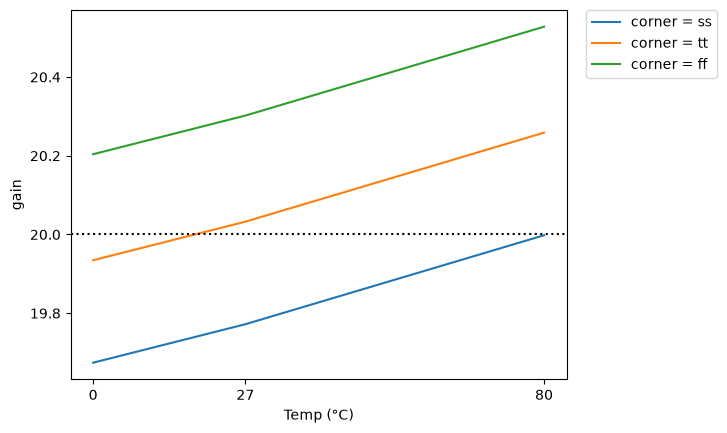

# CACE Summary for tt_um_jonathanwest3_instamp_sp2026

**netlist source**: rcx

|      Parameter       |         Tool         |     Result      | Min Limit  |  Min Value   | Typ Target |  Typ Value   | Max Limit  |  Max Value   |  Status  |
| :------------------- | :------------------- | :-------------- | ---------: | -----------: | ---------: | -----------: | ---------: | -----------: | :------: |
| Gain 26dB            | ngspice              | gain                 |           24 dB |  25.721 dB |        26 dB |  26.100 dB |        28 dB |  26.617 dB |   Pass ✅    |
| Gain 26dB            | ngspice              | bw                   |          80 kHz | 96.853 kHz |      300 kHz | 111.023 kHz |            ​ |          ​ |   Pass ✅    |
| Gain (20dB)          | ngspice              | gain                 |           18 dB |  19.674 dB |        20 dB |  20.032 dB |        22 dB |  20.528 dB |   Pass ✅    |
| Gain (20dB)          | ngspice              | bw                   |         100 kHz | 199.196 kHz |      200 kHz | 230.117 kHz |            ​ |          ​ |   Pass ✅    |
| Rise, fall and slew  | ngspice              | rise                 |          100 ns | 306.866 ns |       300 ns | 376.904 ns |       500 ns | 452.018 ns |   Pass ✅    |
| Rise, fall and slew  | ngspice              | fall                 |          100 ns | 290.287 ns |       300 ns | 355.191 ns |       500 ns | 415.447 ns |   Pass ✅    |
| Rise, fall and slew  | ngspice              | sr_rise              |        0.4 V/us | 0.478 V/us |     0.8 V/us | 0.590 V/us |     1.5 V/us | 0.717 V/us |   Pass ✅    |
| Rise, fall and slew  | ngspice              | sr_fall              |        0.4 V/us | 0.521 V/us |     0.8 V/us | 0.626 V/us |     1.5 V/us | 0.758 V/us |   Pass ✅    |
| Rise, fall and slew  | ngspice              | over                 |               ​ |          ​ |         1 mV |   0.277 mV |         3 mV |   0.845 mV |   Pass ✅    |
| Rise, fall and slew  | ngspice              | under                |               ​ |          ​ |         1 mV |   0.140 mV |         3 mV |   0.231 mV |   Pass ✅    |
| Rise, fall and slew  | ngspice              | ivdd                 |               ​ |          ​ |       500 uA | 1729.970 uA |       750 uA | 1852.170 uA |   Pass ✅    |
| CMRR and PSRR        | ngspice              | CMRR                 |           60 dB |  70.569 dB |        70 dB |  70.723 dB |            ​ |          ​ |   Pass ✅    |
| CMRR and PSRR        | ngspice              | PSRR                 |           60 dB |  15.030 dB |        70 dB |  15.286 dB |            ​ |          ​ |   Pass ✅    |
| Noise                | ngspice              | noise                |               ​ |          ​ |       100 uV | 1745.730 uV |       300 uV | 2805.770 uV |   Pass ✅    |
| Netgen LVS           | netgen_lvs           | lvs_errors           |               ​ |          ​ |            ​ |          ​ |            0 |          0 |   Pass ✅    |
| Magic DRC            | magic_drc            | drc_errors           |               ​ |          ​ |            ​ |          ​ |            0 |          0 |   Pass ✅    |
| Magic Antenna        | magic_antenna_check  | antenna_violations   |               ​ |          ​ |            ​ |          ​ |            0 |          0 |   Pass ✅    |

## Plots

## gain_vs_temperature

## gain_vs_temperature

